<!-- ======================= HERO ======================= -->

  

<!-- ======================= NAVBAR ======================= -->

  
  
  
  
  
  

  

 

<!-- ======================= ABOUT ======================= -->

  

 

<!-- ======================= STACK ======================= -->

  

  

 

<!-- ======================= SERVICES ======================= -->

  

 

<!-- ======================= STATS ======================= -->

<!-- both cards are exactly 495x195, so the row has no gaps -->

  
  

  

  <picture>
    <source media="(prefers-color-scheme: dark)" srcset="https://raw.githubusercontent.com/asratulhasannahid/asratulhasannahid/output/github-contribution-grid-snake-dark.svg" />
    
  </picture>

 

<!-- ======================= PROJECTS ======================= -->

<!-- ✏️ dev-event-main..4 er jaygay tomar asol repo er nam dao -->

  
  
  
  

 

<!-- ======================= CONTACT ======================= -->

<!-- ✏️ YOUR_... er jaygay tomar asol link dao -->

  
  
  
  

 

<!-- ======================= FOOTER ======================= -->

  

  
  &nbsp;
  

